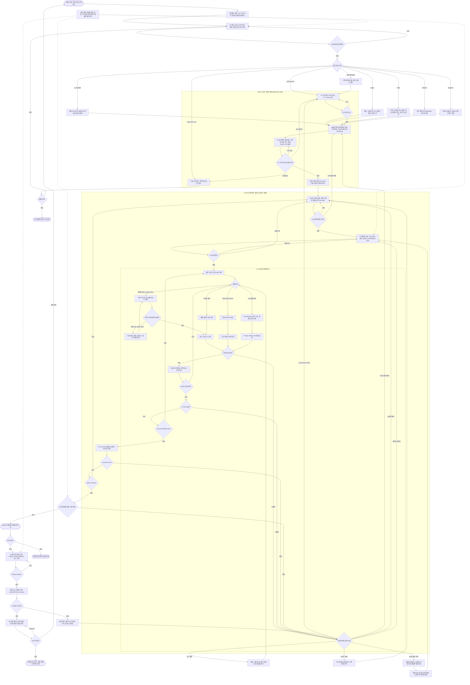
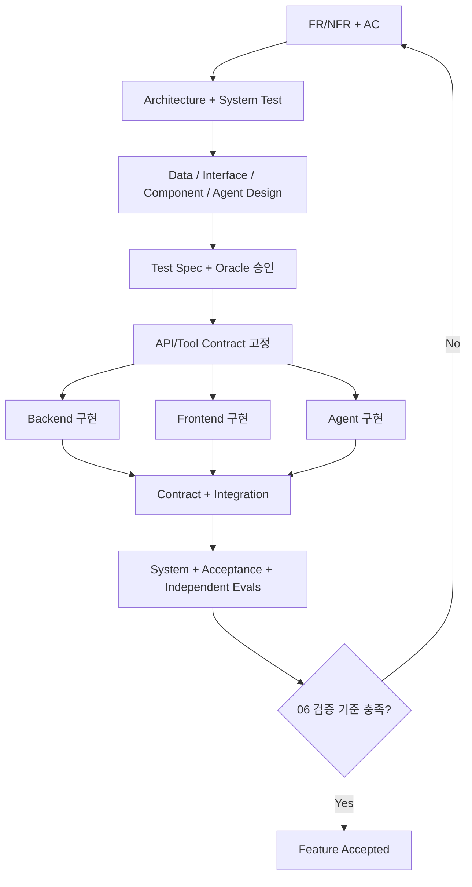

# SDLC Methodology v3.1 — Master Specification

> 상태: Skill 구현 전 방법론 설계안 (Proposed, not an official Kiro / Spec Kit standard)
> 기준일: 2026-11-04
> 개정: 공통 Intake, 위험 기반 경로, Increment 반복, 테스트 독립성, 결함 복귀와 배포 준비 판정을 정렬했다.
> 구현 상태: 방법론과 스킬 아키텍처 설계안이다. 설치된 스킬이나 실행 자동화는 이번 개정으로 변경하지 않는다.
> 목표: Feature 중심 Spec-Driven Development, Risk-based Design, Test-First Execution, Independent Verification을 하나의 운영 프로토콜로 통합한다.
> 우선 참고: Kiro Feature Specs / Steering / Correctness, GitHub Spec Kit SDD / Converge, ISO/IEC/IEEE 29148 / 42010 / 12207, ISTQB CTFL 4.0.1, SWEBOK, Kent Beck의 TDD.

## 0. 설계 결정과 기본 원칙

### 0.1 이 문서의 성격

- 기존 Kiro나 GitHub Spec Kit에 내장된 공식 프로세스가 **아니다**. 두 프레임워크를 참고해 확장한 자체 SDLC 정책이다.
- 향후 하나의 Master Skill이 사용하는 **실행 규약의 원본**이다. 현재는 Skill 설치 파일을 만들지 않는다.
- 프로젝트 수준의 원칙과 아키텍처는 공유하고, Feature별 요구사항, 설계, 실행 및 검증 증거는 분리한다.
- 절차는 순환적이며 병렬화 가능하다. 단계 이름은 논리적 책임을 구별할 뿐 Waterfall을 강제하지 않는다.

### 0.2 불변 원칙 12개

1. **Intent before code:** 구현 이전에 무엇을 충족해야 하는지 식별한다.
2. **Requirement–Design separation:** 사용자에게 보장할 행동과 그것을 만드는 기술적 선택을 구분한다.
3. **Vertical slices first:** Feature는 검증 가능한 사용자 결과 중심으로 분리한다. FE, BE, AI는 그 기능의 Workstream이다.
4. **Proportional rigor:** 변경과 위험에 비례해 설계 깊이와 검증 강도를 선택한다. 불필요한 문서 생성을 강제하지 않는다.
5. **Contract-first at boundaries:** 팀, 서비스, Agent, 데이터 저장소 사이의 인터페이스를 구현 이전에 맞춘다.
6. **Verification designed early:** Requirements에서 Acceptance를, Architecture에서 System을, Interface / Component 설계에서 Contract / Integration / Unit을 구체화한다.
7. **Oracle independent of implementation:** 기대 결과의 근거를 구현 코드와 분리한다. 테스트 작성 Agent와 구현 Agent도 수정 권한을 분리한다.
8. **TDD by default for deterministic behavior:** 작은 동작 변경은 Red → Green → Refactor 순서를 따른다. 테스트가 불가능한 Spike 등은 사유를 남긴다.
9. **Evidence-based gates:** 파일이 만들어졌다는 사실만으로 완료로 판정하지 않는다. 게이트별 증거를 남긴다.
10. **Traceability:** Requirement → Design → Contract → Task → Test → Evidence의 링크를 관리한다.
11. **No silent drift:** 테스트, 명세, 설계, 계약 변경 시 영향 평가와 승인 경로를 거친다.
12. **Convergence ≠ correctness:** 코드가 명세와 일치해도 명세 자체가 틀릴 수 있다. 독립 검증과 인간 검토가 필요할 수 있다.

### 0.3 활동 분류

- `M` (Mandatory): 이 방법론의 기본 경로에서 반드시 확인해야 하는 활동. 간단한 Feature에서는 짧은 메모나 기존 산출물 참조로 만족 가능.
- `C` (Conditional Mandatory): 변경 영향, 위험, 도메인, 환경에 해당할 때 필수로 수행.
- `O` (Optional): 분명한 필요나 추가 가치가 있을 때 선택.
- `G` (Gate): 다음 단계 진행을 결정하는 품질 게이트.
- `N/A`: 대상이 아니므로 생략. 생략 사유는 Design Selection 결과에 기록한다.
- `Waived`: 필요하지만 예외적으로 생략. 권한 있는 승인자, 위험, 보완 조치, 유효 범위 기록 필수.

위 M/C/O는 ISO나 Kiro가 규정한 공식 의무 등급이 아니다.

## 1. 최상위 흐름, 라우팅 및 되돌림



**실제 운영 순서:** 모든 요청은 00의 공통 Intake에서 범위, 위험, 성공 기준과 권한을 확인한 뒤 경로를 선택한다. Feature의 목표와 주요 경계는 먼저 맞추고, 03~06의 관련 작업을 사용자 결과 중심 Increment별로 반복한다. 변경 전체의 인수 조건과 품질 기준도 06에서 확인한다. 02는 기존 구조를 참조할 수 있으며 새 아키텍처 문서를 일괄 생성하지 않는다. 작은 버그도 필요한 회귀 증거는 유지한다. 긴급성은 위험 등급을 낮추는 근거가 아니다.

**상태 구분:** `Feature Accepted`는 요구 충족, `Released`는 배포 후 정상 확인, `Outcome Observed`는 실제 사용자 결과 관측이다. 서로 자동 대체하지 않는다. 이 그림은 정책의 논리 흐름이며 실제 자동 실행이나 권한 강제를 보장하지 않는다.

## 2. 개발 대상의 계층과 작업 크기

| 계층 | 질문 | 마케팅 보조 서비스 예시 | 기본 관리 위치 |
|---|---|---|---|
| Project / Product | 왜 만들고 어떤 결과를 얻는가? | 광고 성과 분석 업무 지원 | 제품 목표, 공통 문서 |
| Epic / Capability | 어떤 큰 업무 영역을 제공하는가? | 마케팅 분석 에이전트 | 로드맵, 기능 목록 |
| Feature | 사용자가 어떤 결과를 독립적으로 얻는가? | ROAS 하락 요인 비교 | Feature Spec |
| User Story / Use Case | 누가 어떤 조건에서 무엇을 수행하는가? | 마케터가 2개 기간을 비교 | Feature Requirements |
| Increment / Vertical Slice | 어느 시점에 작동 가능한 결과를 제공하는가? | 먼저 ROAS 수치 비교, 이후 설명 | Plan, Tasks |
| Workstream | 기능을 구현할 책임 영역은 어디인가? | Frontend, Backend, Agent, Data | Design, Task 속성 |
| Task | Agent가 범위 내에서 무엇을 수정하고 검증하는가? | compare_roas() 구현 | Task, Branch, PR |
| Test / Evidence | 무엇을 근거로 완료를 승인하는가? | Golden 데이터와 계약 / E2E 통과 | Verification |

### 2.1 분할 정책

- Feature 분할은 **독립적인 사용자 가치, 독립적인 인수 조건, 단계별 제공 가능성**을 우선한다.
- 하나의 Feature에서 여러 사용자 행동 또는 별도 위험 판단이 있으면 Sub-feature / Increment로 나눈다.
- `Frontend 개발`, `LangGraph 구축`, `RAG 구축`은 기본적으로 Feature가 아니라 Workstream / 기술 Task다. 단 공통 플랫폼 역량 자체가 독립 산출물이면 Enabler Feature로 관리할 수 있다.
- Task 분할은 **독립적인 완료 조건, 변경 범위, 의존성, 되돌리기 가능성, 테스트 가능성**으로 판단한다.
- Task가 둘 이상의 주요 설계 결정을 즉석에서 요구하면 설계를 다시 구체화한다.
- 전체 Feature 수락은 FE/BE/AI 모든 Task 체크 여부가 아닌 인수 시나리오의 성공으로 결정한다.

## 3. 프로젝트 공통 기반, One-Time/On-Change

### 3.1 Constitution / Steering [M]

- 목적, 대상 사용자, 제품 원칙, 금지 사항, 품질 우선순위, 보안 최소 기준
- 기술 스택과 허용된 의존성, 리포지토리 구조, 코드 스타일, 테스트 실행법
- 프로젝트 수준 Architecture, 시스템 경계, 공통 데이터 정의, ADR 이력
- 변경 승인 권한: 요구사항 소유자, 설계 승인자, Test Oracle 승인자, Release 승인자
- 문서와 코드의 단일 기준 위치, 충돌 시 우선순위

### 3.2 기존 프로젝트의 시작 [C]

- 현재 코드와 디렉터리, 빌드, 테스트, CI, 배포, DB / API 계약 확인
- 현행 구현의 행동과 의도된 계약을 구분한다. 현재 코드가 곧 올바른 요구사항이라는 전제는 금지.
- 기존 테스트 커버리지, 알려진 결함, 보안/성능 위험, 데이터 마이그레이션 경로 확인
- 기존 Architecture/ADR을 우선 참조하고, 중요한 변경만 ADR 추가

## 4. 00 — Intake, Framing, Risk Classification

G0는 이번 변경의 문제와 범위, G1은 인수할 동작, G2는 구조와 시스템 검증을 다룬다. 신규 프로젝트의 첫 출시와 기존 프로젝트의 개별 변경에 같은 기준을 적용한다. 필요한 단계만 선택하고 유효한 기존 근거를 재사용한다. 실제 적용은 [단계 선택 기준](../sdlc/references/lifecycle.md)과 [산출물 규칙](../sdlc/references/artifact-layout.md#초기-기록과-명세)을 따른다.

**입력:** 사용자 요청, 이슈, 사고, 변경 제안, 기존 프로젝트 문서.

### 4.1 순서

1. [M] 요청 식별자, 종류(New Feature / Bug / Hotfix / Refactor / Spike / Migration / Operations), 소유자 기록.
2. [M] 비즈니스 문제, 사용자, 성공 결과, 현재 문제의 재현 또는 증거 정의.
3. [M] In/Out of Scope, 제약, 금지 행동, 기존 시스템 영향 식별.
4. [C] 범위를 나눠야 할 때 Feature나 Increment 후보를 정한다.
5. [M] 데이터 민감도, 금액 / 보안 / 안전 영향, 규모, 불확실성, 가역성, 외부 연동을 평가해 위험 등급 지정.
6. [C] 기술적 불확실성이나 비용 상한이 중요하면 Time-boxed Spike, PoC, Benchmark 수행. Spike 결과를 프로덕션 코드로 무검증 승격하지 않는다.
7. [O] 경쟁 서비스, 사용자 리서치, 수익/비용 타당성 조사.

**산출물** 기존 요청 정본 또는 변경별 `intake.md`에 목표, 포함 범위와 제외 범위, 착수 위험과 미결을 기록한다.
**G0** 이번에 해결할 문제와 착수 범위가 명확한가?

### 4.2 위험 등급 예시, 제안 정책

| 등급 | 대표 상황 | 필수 강화 조치 |
|---|---|---|
| L0 | 문구, 스타일, 동작 변경 없음 | 축약 Spec, 관련 검사 |
| L1 | 한 컴포넌트의 일반 동작 변경 | Acceptance, 관련 Unit / Component Test |
| L2 | API / DB / Agent / 여러 컴포넌트 경계 | 설계/계약, 통합 테스트, TDD, 독립 검증 |
| L3 | 결제, 권한, 개인정보, 데이터 손실, 고가용성 | 명시 승인, 위협/실패 분석, 강한 회귀 및 롤백 |

위 분류는 표준 등급이 아니다. 단순한 코드 변경이어도 위험 영향이 크면 높은 등급을 적용한다.

## 5. 01 — Requirements Engineering + Acceptance Design

**입력:** Intent, Scope, 기존 계약, 도메인 지식. **핵심 질문:** 무엇을 보장해야 하는가?

### 5.1 요구사항 분석

1. [M] Actor / Stakeholder, 사용 맥락, 목표 결과 정의.
2. [M] User Story, Use Case, 정상 흐름, 대체 흐름, 실패 흐름 작성.
3. [M] 각 FR에 `FR-###` 부여, 트리거와 관찰 가능한 시스템 반응 작성. EARS 형식 사용 가능.
4. [M] NFR을 측정 가능하게 작성: 응답시간 / 처리량 / 가용성 / 정확성 / 비용 / 감사 / 접근성 등. 수치는 근거가 없으면 **TBD**로 표시하고 임의로 확정하지 않는다.
5. [M] 비즈니스 규칙, 계산식, 단위, 기간 / 시간대, 필터, 누락 데이터 / 환불 / 중복 등 의미 정의.
6. [M] 인증/인가, 개인정보, 금지 동작, 경계 상황, 실패와 복구 기대 동작 정의.
7. [M] Out of Scope, 외부 의존성, 가정, 우선순위 기록.
8. [M] 요구사항 간 중복, 모순, 누락, 확인되지 않은 가정 검토.
9. [C] UI Journey / 프로토타입, Story Mapping, 도메인 용어집, 업무 규정 검토.

### 5.2 Acceptance / Oracle 초안, 구현 전 [M]

- 각 핵심 FR에 대해 `AC-###` 생성. `Given–When–Then` 또는 조건 / 입력 / 기대 출력 사용.
- 정상, 경계, 오류, 권한 거부, 데이터 없음, 성능/안전 등 시험 가능한 조건 정의.
- 기대값의 출처: 승인된 업무 공식, 도메인 소유자 확인, 정답표, 공개 규격, 검증된 독립 참조 구현. 구현 코드를 보고 기대값을 사후 생성하지 않는다.
- Golden Data의 버전 / 출처 / 의미 / 엣지케이스 기록.
- 아직 구체적인 테스트 환경이나 코드가 결정되지 않았다면 `test_intent`, `oracle_source`, `pass_criteria` 수준으로 기록.

**산출물** 기존 명세나 이슈에 기대 동작과 인수 조건을 연결한다. 분리할 때는 변경별 `requirements/R001-*.md`에 기록한다.
**G1:** 모든 핵심 FR에 관찰 가능한 결과와 검증 기준이 있는가? 중요한 미확정 값은 승인된 TBD로 구분되어 있는가? 모호하거나 반증 불가능한 요구사항은 없는가?

## 6. 02 — Architecture Impact Review + System Test Design

관련 요구와 인수 기준을 참조하고, 이번 변경이 시스템 경계, 책임, 의존성이나 주요 품질 위험에 영향을 줄 때 02를 적용한다. 기존 구조에서 세부 계약만 정하면 03을 선택한다. 상세 분석에서 구조 영향이 드러나면 02를 추가한다.

**입력:** 승인된 Requirements, 기존 아키텍처, NFR과 제약. **핵심 질문:** 어떤 구조가 이 요구를 만족시키는가?

### 6.1 Architecture Design [M / C]

1. [M] Architecture Drivers: 기능 요구와 핵심 품질 요구, 제약, 운영 모델 추출.
2. [M] 시스템 경계, 사용자 / 외부 시스템, 내부 컴포넌트의 책임과 소유권 정의.
3. [M] 데이터 흐름, 제어 흐름, 호출 방향, 의존성, 동기/비동기 경계 정의.
4. [M] 기존 시스템을 변경할 것인지, 새 컴포넌트를 도입할 것인지 구분.
5. [C] C4 Context / Container / Component, 배포 구조, 시퀀스, 장애 전파 다이어그램 작성.
6. [C] Layered / Modular Monolith / Hexagonal / Event-Driven / Microservices 등 패턴 비교.
7. [C] 트랜잭션과 데이터 소유권, 동시성, 읽기/쓰기 일관성, 장애 격리, 확장성 결정.
8. [C] Single-Agent / Workflow / Multi-Agent 필요성, RAG 필요성, 정형 조회 vs 문서 검색 역할 분리.
9. [C] 신규 기술의 성능 / 비용 / 보안 / 호환성 / 운영 난이도 비교, 미해결이면 Spike 수행.
10. [C] 되돌리기 어려운 주요 기술 결정은 ADR로 대안, 선정 근거, 결과, 검증 증거 기록.
11. [M] Architecture가 FR/NFR을 커버하는지 확인하고 추적 관계 연결.

### 6.2 System Test를 구현 전에 설계 [M]

- **대상:** 전체 시스템의 사용자 관찰 동작, 품질 목표, 시스템 전반의 실패와 복구.
- **명세 항목:** 시나리오 ID, 관련 FR/NFR, 사전조건, 환경 경계, 외부 의존성/대체물, 입력/행동, 기대 시스템 출력, 관측 지점(응답, 로그, 지표, 저장 상태), 판정 규칙.
- **환경:** 실제 서비스와 유사한 범위를 어떻게 구성할지, 데이터 시드 / 외부 의존성 대체 방식 정의.
- **시나리오:** 정상 경로, 서비스 타임아웃, 권한 거부, 부분 데이터, 성능 예산 초과, 장애 후 복구.
- **구현 전 가능:** 무엇을 시험할지, 어떤 결과여야 할지, 어떻게 관측할지 명세.
- **실제 시스템 필요:** 실행 가능한 전체 E2E 스크립트, 실제 부하 수치, 환경 특유의 실패 결과 검증.

**산출물** 변경별 `architecture/A001-*.md` 또는 기존 구조 정본에 결정과 시스템 검증을 연결한다. 공통 아키텍처와 중요한 ADR은 공통 문서 루트에서 관리한다.
**G2:** 주요 경계와 책임, 기술 위험, 시스템 검증 방법이 명확한가? 거대한 설계 미확정 상태에서 코딩으로 넘어가지 않는가?

## 7. 03 — Design Selection Policy + Detailed Design

### 7.1 선택 알고리즘 [M]

최초 선택은 02 진입 전에 수행하고, 여기서는 현재 Increment의 상세 영향에 맞게 재확인한다. Feature의 핵심 경계와 계약은 먼저 정렬하되, 뒤 Increment의 모든 내부 설계를 미리 확정하지 않는다.

1. Feature에서 변하는 사용자 행동, 데이터, 경계, 상태, 안전 영향, 배포 단위를 목록화한다.
2. 기존 프로젝트의 관련 설계가 있는지 찾는다.
3. 아래 Trigger Matrix의 활성화 여부를 `Required`, `Referenced`, `N/A`, `Waived`로 기록한다.
4. Required이면 해당 Design Playbook으로 이동한다. Referenced이면 기존 설계 문서를 연결하고 변경 여부만 검사한다.
5. 각 활성 설계마다 **동일한 단계에서 관련 Test Specification을 생성하거나 갱신**한다.
6. 핵심 설계 결정을 ADR, 계약과 추적 ID에 연결한다.
7. 안전/보안/데이터 손실 등 위험이 높으면 수준을 상향하고, 필요하면 독립 Reviewer 승인을 받는다.
8. 수행하지 않는 문서는 자동 생성하지 않는다. 필요가 없는 이유가 모호하면 Design Review에서 확인한다.

### 7.2 Design Trigger Matrix

| Design Playbook | 활성화 트리거 | 주요 항목 | 대응하는 선행 테스트 설계 |
|---|---|---|---|
| Domain Design | 용어, 업무 규칙, 개념 관계, 여러 Context | Domain Model, Context Map, Aggregate, Rule Table | 업무 규칙 Test, 상태/정책 표 |
| Data Design | 스키마, 필드 의미, 변환, 정합성, 저장 변경 | Conceptual/Logical/Physical, ERD, Dictionary, Lineage, Migration | 스키마/정합성/변환/마이그레이션 검증 |
| Architecture Design | 서비스 경계, 패턴, 주요 의존성, 런타임 변화 | C4, ADR, Runtime, Fault Domains | System, NFR, Architecture Fitness |
| Interface Design | FE–BE, BE–Agent, Tool, RPC, Event, 외부 연동 | OpenAPI, Protobuf, Event Schema, Input/Output/Error, Version | Consumer/Provider Contract Test, 호환성 |
| Component/Procedural | 복잡한 알고리즘, 분기, 상태, 동시성 | Responsibility, Pseudocode, Decision Table, State Machine | Unit, Property, State Transition, Edge |
| Frontend/UX | 화면, 상호작용, 탐색, 접근성 변경 | User Flow, Screen Spec, UI State Matrix, A11y | Component, Visual/Interaction, E2E |
| AI/Agent/RAG | LLM, Prompt, Tool, RAG, Agent Flow 변경 | Agent Graph, Tool Policy, Context, Retrieval, Model/Eval | Tool Contract, Golden Eval, Safety, Quality/Cost |
| Security/Privacy | 인증/권한, 사용자 데이터, Trust Boundary, 외부 실행 | Threat Model, Permission Matrix, Data Classification | Authz Negative, Injection, Sensitive Data Leakage |
| Performance/Resilience | 처리량, 지연, 비용, 장애 복구 요구 | SLO/SLI, Caching, Retry/Backoff, Capacity, Degradation | Load/Soak, Fault Injection, Recovery |
| Deployment/Operations | 환경, Migration, CI/CD, 롤백 변경 | Topology, IaC, Release Strategy, Runbook | Smoke, Migration, Rollback, Disaster Recovery |

### 7.3 Design Playbook 세부 내용

#### 7.3.A Domain

- 용어집, 동일 개념의 다른 명칭, Entity / Value Object, 비즈니스 규칙, Aggregate / Bounded Context (필요시), 상태 불변조건.
- 수식 / 정책 / 예외 / 권한의 판정 근거, Domain Event의 의미와 타이밍.
- 과도한 DDD 적용은 피하고, 업무 규칙이 복잡할 때 깊게 설계.

#### 7.3.B Data

- 개념 모델, 논리 모델, 물리 모델 / Schema, Key / FK / Index / Unique / Nullable / Check.
- 데이터 사전: 필드 의미, 단위, 시간 기준, 통화, 수집 출처, 결측 / 중복 / 정정 규칙.
- Data Flow / ETL / ELT, 원본과 산출물 관계, lineage, 재처리, 멱등성, 데이터 품질 지표.
- Migration의 backward/forward compatibility, backup, retention, deletion, 롤백 가능성.
- 데이터 불변조건과 Seed / Fixture / 변환 테스트 명세.

#### 7.3.C Interface and Contract

- Consumer / Provider, 호출/이벤트/Tool 경계, 책임, API 버전과 호환성, Idempotency.
- Request, Response, Status, Error, Nullability, Pagination, Rate Limit, Authentication/Authorization.
- Timeout, Retry, Backoff, Partial Failure, Ordering, Delivery Guarantee, Correlation ID.
- OpenAPI / JSON Schema / Protobuf / AsyncAPI 등 실행 가능한 스키마 우선.
- 계약의 예시 데이터와 Positive/Negative Tests를 구현 전 작성.

#### 7.3.D Component, Procedure and Behavioral

- 책임, 공개 인터페이스, 내부 상태와 의존성, side effect, pure function 구분.
- 호출 순서 Sequence, 분기 Flowchart, State Machine, Transition Table, Decision Table.
- 복잡한 알고리즘에는 Pseudocode와 시간/공간 복잡도, 정확성 조건.
- Preconditions, Postconditions, Invariants, 오류 분류, 취소 / 보상 / 재시도 / 중복 호출.
- 동시성, Lock, Isolation, 원자성, Race, Cache Invalidation이 관련되면 추가.

#### 7.3.E Frontend and UX

- User Journey / User Flow / Information Architecture / Wireframe, 기능과 화면 매핑.
- Component Responsibilities, Client State, Server State, Cache, Navigation, Form Validation.
- Success / Loading / Empty / Error / Permission Denied / Partial Result 상태.
- Accessibility, Responsive, Localization, Keyboard, Feedback, Error Recovery.
- 백엔드 계약과 UI Mock, 컴포넌트 / E2E 시나리오 연결.

#### 7.3.F AI, Agent and RAG

- LLM이 필요한 이유와 Rule / SQL / Search / Deterministic Function 대안 검토.
- Single Agent vs Multi-Agent vs Fixed Workflow 결정, Orchestrator, Handoff, Tool Graph.
- Model / Provider 선택 기준, 품질 / 지연 / 비용 / Rate Limit, 장애 시 Fallback.
- Prompt 버전, Context Budget, Conversation State, Memory / Privacy 정책.
- RAG가 필요한 경우 데이터 출처, Chunking, Embedding, Index, Hybrid Retrieval, Rerank, Freshness, Citation 정책.
- 정형 수치는 서버 계산, LLM은 도구 선택과 설명 등으로 책임 분리 (필요시).
- Tool ACL, Human Confirmation, Side-effect Gating, Prompt Injection / Data Exfiltration 방어.
- Eval Dataset, Holdout, Baseline, Groundedness, Tool Correctness, Format, Safety, Latency / Cost Threshold, Trace.
- 확률적 결과의 Pass/Fail은 반복 횟수, 허용 변동, CI에서 사용하는 모델 버전을 명시.

#### 7.3.G Security / Privacy

- Trust Boundary, 위협 모델, 인증 / 인가, 최소 권한, 데이터 분류 / 마스킹 / 암호화 / 보존.
- Secret / Dependency / Supply-Chain, Audit, Abuse and Rate Limit, 사용자 격리.
- AI Tool 사용 시 Excessive Agency와 Prompt Injection 경로 검토.

#### 7.3.H Deployment / Observability / Performance

- Environment / Network / Config / IaC / CI-CD, 환경별 차이.
- Monitoring: Logs / Metrics / Traces / SLI, Error Budget, Alert / Runbook.
- Migration, Feature Flag, Canary / Blue-Green, Backup / Restore / Rollback.
- Throughput, Resource, Caching, Cost Budget, Latency, Capacity / Load Test.

### 7.4 Test Design Specification, 모든 활성 설계의 공통 출력 [M]

모든 `test_case` 또는 `test_condition`은 최소 아래 필드를 가진다.

```yaml
id: CT-003
level: contract            # acceptance|system|contract|integration|unit|e2e|nfr|ai_eval
requirement_refs: [FR-003]
design_refs: [IF-002]
contract_refs: [API-001]
purpose: "ROAS 분석 응답의 데이터 계약 검증"
preconditions: ["권한이 있는 사용자", "테스트 캠페인 데이터 준비"]
inputs: {campaign_id: "A", period: "2026-10"}
expected:
  schema: "AnalysisResponseV1"
  invariants: ["spend=0이면 roas가 임의의 유한 수로 반환되지 않음"]
oracle:
  type: "approved_spec_or_golden_dataset"
  source: "AC-003 / golden_roas_v1.csv"
observability: ["HTTP response", "Tool invocation trace"]
execution_stage: "before_merge"
status: "planned"           # planned|coded|red_verified|pass|fail|blocked|waived
owner_role: "test_agent"
```

- 테스트 명세 자체는 구현 전 확정할 수 있다. 전체 시스템 실행 스크립트는 환경 구성 시 작성해도 된다.
- 계약 테스트는 Producer와 Consumer가 동일한 Schema와 의미를 준수하는지 검증한다.
- 통합 테스트는 실제 연결에서 데이터 흐름, 예외 전파, 재시도, 상태/트랜잭션 등을 검증한다.
- 시스템 테스트는 구성된 시스템 전체의 외부 행동과 NFR을 확인한다.
- 인수 테스트는 사용자가 약속받은 결과를 얻는지 판단한다. 동일한 E2E 경로라도 목적에 따라 분류가 다를 수 있다.

**G3:** 활성 설계가 모두 상위 요구사항을 커버하는가? 경계 계약, 오류와 상태, 테스트 Oracle, NFR이 일치하는가? 모든 생략이 합리적인가?

## 8. 04 — Design Review, Consistency Analysis, Task Planning

**입력:** Requirements, Architecture, Selected Design, Contracts, Test Specifications.

1. [M] 요구사항 ↔ 설계 ↔ 테스트 간 누락, 모순, 용어 불일치 검사.
2. [M] 기술 대안 / ADR / 미해결 결정 검토. 위험한 TBD가 남으면 보류.
3. [M] 시스템, 데이터, API, Tool 계약을 공유하고 변경 승인 기준 확정.
4. [M] 02 이후 정의한 사용자 결과 중심 Increment를 재확인한다. 현재 Increment의 상세 설계와 Task를 우선 구체화하고 후속 Increment는 의존성과 핵심 계약 수준으로 유지할 수 있다.
5. [M] 각 Increment를 FE / BE / AI / Data / Infra / Test 등 Workstream Task로 분해.
6. [M] Task ID, Owner Role, Inputs, Dependencies, Paths, Output, Acceptance, Tests, Risk 기록.
7. [M] Task DAG 작성, 병렬 가능한 작업과 공통 파일 충돌 식별.
8. [M] Golden Data / Mock / Stub / Service Virtualization, CI 환경 준비 계획.
9. [M] 테스트 기준, 구현, 독립 검증의 책임과 수정 권한을 정의한다. 별도 Agent, Worktree, 브랜치 사용은 환경과 위험에 따라 선택하며 기존 동시 실행 상한과 승인을 보존한다.
10. [C] Spec Kit 같은 정합성 Analyzer 또는 별도 리뷰 시행. 자동 검사에서 발견한 결함은 원본 명세를 수정하고 재검사.
11. [C] 일정, 담당자, PR/릴리스 그룹, Feature Flag 정책 기록.

### 8.1 Task 최소 메타데이터

```yaml
id: T-014
feature: F-003
increment: I-001
workstream: backend
owner_role: implementation_agent
depends_on: [T-011, T-012]
reads: ["spec.md", "design.md", "contracts/analysis-api.yaml", "tests/test-spec.md"]
writes: ["services/api/src/features/roas/**"]
forbidden_writes: ["specs/**/golden/**", "tests/approved/**"]
goal: "승인된 ROAS 계산 계약을 제공하는 API 구현"
acceptance_refs: [AC-003, AC-004]
test_refs: [UT-004, CT-003]
done_when: ["승인 테스트 통과", "계약 검사 통과", "리뷰 통과"]
```

**G4:** 모든 Task의 맥락, 경계, 의존성과 검증 방법이 충분한가? 병렬 작업에 공통 계약과 파일 충돌 방지가 존재하는가?

## 9. 05 — Implementation: Independent-Agent TDD

### 9.1 Agent 역할 분리

| 역할 | 입력 | 생산물 | 제품 코드 수정 | 승인 테스트 / Oracle 수정 |
|---|---|---|---|---|
| Spec Agent | Intent, 근거 자료 | FR/NFR/AC, 모호성 목록 | 금지 | 변경 제안만 |
| Design Agent | Spec, 기존 구조 | Architecture, Design, Contract, ADR | 금지 (원칙) | Test Design 수정 제안 |
| Test Agent | 승인된 요구사항, 계약, Oracle | 테스트 코드, Fixture | 금지 | 승인된 범위만 |
| Implementation Agent | Spec, Design, Contract, 공개 테스트 | 제품 코드, 자체 개발용 로컬 테스트 | 허용 범위 내 | 금지 |
| Verification Agent | 승인 문서, 테스트, 빌드 결과 | 독립 검증 보고, 추가 결함 | 금지 | 금지 |
| Reviewer / Owner | 위험, 변경 제안, 증거 | 승인 / 반려 / Waiver | 승인된 절차로 | 승인된 절차로 |

**핵심:** 다른 이름으로 Agent를 부르는 것만으로 분리가 되지 않는다. 가능하면 Worktree / 파일 권한 / PR 리뷰 / CI Path Guard로 수정 권한을 강제한다.

### 9.2 Red → Green → Refactor 표준 루프

1. [M] Task 경계와 관련 FR, AC, Contract, Oracle를 고정 또는 버전 지정한다.
2. [M] 인수 조건, 핵심 계산과 보안 정책의 기대값은 승인된 독립 근거로 작성한다. 내부 Unit Test, Fixture와 테스트 환경은 구현의 공개 인터페이스나 구조를 참조할 수 있지만, 구현 결과 자체를 정답의 근거로 사용하지 않는다.
3. [M] **Red:** 해당 기능이 미구현 또는 잘못 구현된 이유로 실패함을 확인한다. Import Error, Test Setup 실패를 정상적인 Red라고 취급하지 않는다.
4. [M] 승인된 행동과 합격 기준을 버전으로 고정한다. 기준을 바꾸는 수정은 별도 검토하며, 의미가 변하지 않는 Fixture와 환경 수정은 정해진 권한 안에서 처리한다. 모든 작은 TDD 반복에 별도 병합을 강제하지 않는다.
5. [M] Implementation Agent가 가장 작은 단위로 기능을 작성하고 테스트를 실행한다.
6. [M] **Green:** 승인된 테스트를 통과한다. 테스트 건너뛰기, 조건 약화, 기대값 바꾸기 금지.
7. [M] **Refactor:** 동작 불변 상태에서 코드 단순화, 설계 일치, 정적 검사, 회귀 테스트.
8. [M] 커밋 / 변경 Diff / 테스트 실행 로그를 Task 증거로 기록한다.
9. [C] 통합 지점에 도달하면 Contract/Integration/E2E 테스트를 실행한다. 각 단위가 완료되어도 Feature 전체는 아직 미완료일 수 있다.
10. [C] 안정적인 테스트를 먼저 작성하기 어려운 Prototype/Spike/레거시 코드에는 Characterization Test 또는 탐색 절차를 사용하고 예외를 기록한다.
11. [M] 다음 동작은 검증 방식 선택으로 돌아간다. 다음 Task는 DAG의 실행 가능 항목으로 이동한다. Task 완료를 곧바로 Feature 완료로 취급하지 않는다.
12. [M] 동작 보존 Refactor는 통과 Baseline과 동등성 검증을 사용한다. 확률적 AI 동작은 Eval Baseline, 반복 조건과 승인된 품질/비용 기준을 사용하고, 주변 결정적 로직에는 TDD를 적용한다.

### 9.3 실패 및 테스트 변경 프로토콜

- **Test Fail, Implementation Defect:** Implementation Agent가 제품 코드 수정.
- **Test Fail, Contract Mismatch:** Design / Contract Owner가 계약 검토, 변경 승인 후 양쪽 구현과 테스트 동시 갱신.
- **Test Fail, Bad Oracle:** 도메인 근거로 Test Agent가 변경 제안, 승인자 리뷰 후 새 Oracle 버전 발행. 구현 Agent의 임의 변경 불가.
- **Test Flaky:** 재현, 시간 / 순서 / 네트워크 독립성, 격리 검증. 원인을 확인하지 않고 무조건 Skip 금지.
- **Spec Incorrect:** 사용자 / 도메인 승인자에게 돌아가 요구사항과 모든 하위 산출물에 변경 전파.
- **API Incompatible:** 계약의 Breaking Change 정책에 따라 버전, Consumer Update, Migration 적용.

### 9.4 독립성 확보의 한계와 보강

- TDD에서 구현 Agent가 공개 테스트를 보는 것은 정상이다. **테스트를 못 보게 하는 것**이 아니라 **기대값을 임의 수정하지 못하게 하는 것**이 목표다.
- Test Agent와 Implementation Agent가 같은 잘못된 명세를 공유하면 양쪽이 동시에 틀릴 수 있다.
- 따라서 Golden Dataset, Property / Metamorphic Relation, 외부 규격, 독립 참조 계산, Holdout Evaluation을 보완적으로 사용한다.
- 구현 Agent가 보지 못하는 Holdout Test가 있다면 결과 요약과 재현 조건을 제공하되, 검증 세트 오염/노출을 관리한다.
- AI 응답의 불확실성은 deterministic Unit Test만으로 검증하지 않는다. 분리된 Eval 및 반복 실험을 운영한다.

**G5:** Task별 승인 테스트, 형검사/린트, 관련 계약 및 회귀 검증이 통과했는가? 테스트 조작, 경로 이탈, 명세 미반영이 없는가?

## 10. 06 검증 및 통합

### 10.1 검증 수행 순서

06에서 필요한 Increment 통합과 사용자 시나리오를 확인한다. 다음 Increment가 있으면 필요한 설계부터 진행한다. 변경 전체를 확인할 때는 관련 인수 조건, 품질 요구, 경계 간 회귀와 적용되는 독립 검증을 수행한다. 05에서 가능한 통합 검사도 실행한다.

새 코드 결함은 재현, 기존 테스트 확인, 필요한 회귀 실패 추가 후 수정한다. 결함과 변경은 요구/Oracle 의미, 구조, 설계/계약, 계획, 코드, 테스트, 환경/설정/이행으로 분류해 가장 가까운 책임 지점으로 되돌린다. 상위 기준이 달라지면 영향받는 하위 Gate와 증거를 재확인한다.

1. [M] 빌드와 CI에서 Unit, Component, Contract, Integration 테스트 실행.
2. [M] 사용자가 관찰하는 핵심 흐름의 System / E2E / Acceptance 테스트 실행.
3. [M] 경계, 오류, 권한 거부, 중복 요청, 실패 후 복구, 관련 회귀 실행.
4. [M] 요구사항별 통과/실패/미실행/면제 상태를 Trace Matrix로 집계.
5. [C] 성능, 부하, 안정성, A11y, Security, Privacy, Migration, Recovery Test 실행.
6. [C] AI: 평가 데이터셋, Tool 호출 정확성, Groundedness, 안전, Prompt Injection, 품질/비용/지연을 평가.
7. [C] PBT, Metamorphic / Differential, Mutation Test를 통한 테스트 품질 검증.
8. [M] Spec / Plan / Tasks와 코드 간 누락을 검토. Spec Kit의 `converge`와 같은 갭 분석을 참고하되, 독립적인 Acceptance와 구분.
9. [M] 결함을 `requirements`, `design`, `contract`, `test`, `implementation`, `environment`로 분류해 해당 단계로 회귀.
10. [M] 잔여 위험, Waiver, 배포 제약, 검증 증거를 승인자에게 보고.

### 10.2 검증 결과 판정

- **Pass:** 승인된 Acceptance, 필요한 Contract/Integration/System, 관련 NFR과 안전 기준 충족.
- **Fail:** 관련 단계로 회귀하고, 수정이 끝난 뒤 영향 범위 회귀 실행.
- **Blocked:** 환경/외부 시스템/접근 문제로 검증 불가. 검증 실패를 성공으로 취급하지 않음.
- **Waived:** 정당화 및 책임자 승인, 잔여 위험, 추적 ID, 만료 조건 기록.
- 명세와 구현의 일치 여부와 함께 적용되는 인수 및 품질 기준을 확인해 06 결과를 판정한다.

## 11. 07 — Release, Deployment, Transition

배포 전 `Release Ready` 판정과 배포 후 `G7`을 구분한다. Ready는 배포 권한과 Artifact, Config, Migration 호환성, 중단 기준, 복구와 관측 준비를 확인한다. G7은 배포 후 실제 정상 동작을 확인한다.

실패하면 배포 중단, 롤백 또는 별도 데이터 복구로 서비스를 안정화한다. 이후 코드/설정/환경/이행 등 원인을 분류해 수정하고, 관련 검증과 Release Ready를 다시 수행한다. 모든 장애를 제품 코드 수정으로 보내지 않는다.

1. [C, 실제 배포 시 필수] 대상 환경과 버전, 변경 목록, 기능 토글, 데이터 이행 순서 결정.
2. [C] 빌드 재현성, 환경 설정 / Secret / 자격 증명 / 권한 확인.
3. [C] 마이그레이션, Backfill, API 호환성, 백업/복구, 롤백 가능성 확인.
4. [C] Canary / Rolling / Blue-Green / Feature Flag 등 위험에 맞는 배포 전략 선택.
5. [C] Smoke Test, Critical Journey, 서비스 지표, 실패 시 중단 기준 정의.
6. [C] Release Notes, Runbook, Support/On-call, 사용자 공지 정리.
7. [M, 배포 대상] 실제 배포 관측 후 성공/실패, 버전, 관련 Evidence 기록.

**G7:** 정상 서비스가 확인되었는가? 문제 발생 시 중단/롤백이 가능한가? 데이터 롤백이 불가하면 별도 복구 전략이 있는가?

## 12. 08 — Operations, Evolution, Retirement

1. [C, 운영 서비스] Error Rate, Latency, Saturation, Business KPI, Data Quality 등 관측.
2. [C] Alert, Incident Response, 장애 등급, Postmortem, 재발 방지 관리.
3. [C] AI: Tool Failure, Retrieval/Answer Quality, Prompt/Model Drift, Token Cost 감시.
4. [C] 개인정보 삭제, 로그 보존, 권한 검토, Dependency/취약점 갱신.
5. [M] 피드백과 장애를 새로운 Intake / Bugfix / Improvement Spec으로 연결.
6. [C] 데이터 이관/삭제, 서비스 종료, 계약 종료와 감사 기록.

**G8:** 유지, 개선, 확장, 폐기의 다음 의사결정이 확인되었는가?

## 13. Exit Gate Checklist, 단계별 최소 Evidence

| Gate | 필수 질문 | 증거 | 실패할 때 |
|---|---|---|---|
| G0 | 사용자 문제, 범위, 위험이 분명한가? | Intent / Scope / Risk | Framing 재작성 |
| G1 | FR/NFR과 AC가 일관되고 시험 가능한가? | Requirements / Acceptance / Oracle | 요구사항 수정 |
| G2 | 경계, 책임, 기술 대안, System Test가 명확한가? | Architecture / ADR / System Test | Architecture 수정 |
| G3 | 관련 Detailed Design, Contract, Test Design이 완성되었나? | Design Manifest / Contracts / Test Specs | 필요한 설계만 보강 |
| G4 | Task DAG와 소유권, 파일 범위, 독립 테스트 준비가 되었나? | Task Plan / Ownership / Mocks | Plan 조정 |
| G5 | 작업별 Red-Green-Refactor와 필수 CI가 확인됐나? | Test Logs / Diff / Review | 제품 코드 또는 승인 테스트 수정 |
| 06 검증 및 통합 | 적용되는 통합, 인수 조건, 품질, 회귀, 독립 검증 기준을 충족했나? | Verification / Trace | 결함 유형에 따라 01~05 복귀 |
| G7 | 안전한 배포, 복구, 모니터링이 준비됐나? | Release Record / Smoke / Rollback | 배포 중단/롤백 |
| G8 | 운영 피드백을 다음 결정에 반영했나? | Metrics / Incident / Next Intake | 관측/분석 보강 |

## 14. Cross-Cutting Policies

### 14.1 Traceability and Change Control

- Requirement, Design, Contract, Task, Test, Evidence 각각 고유 ID와 버전/경로를 갖는다.
- Trace는 최소 `REQ → AC → Design/Contract → Task → Test → Evidence`로 이어진다. 모든 사소한 코드 줄까지 추적할 필요는 없다.
- 새로운 Requirement = 해당 Design, Task, Test 영향 분석 후 갱신.
- Design 변경 = 영향받는 계약, 구현, 테스트 갱신. 중요한 결정은 ADR 추가.
- Test Oracle 변경 = 출처, 변경 이유, 승인자, 변경 전후 기대값 기록.
- 코드가 명세와 다르면 코드 기준으로 명세를 조용히 수정하지 않는다.

### 14.2 문서와 Issue의 권한

- `docs/` / `specs/`: 제품 의도, 계약, 설계, 검증 기준의 **Source of Truth**.
- `tasks.md`: 개인/소규모 AI 개발의 구현 작업 DAG, 결과 기록.
- GitHub Issue / Project: 팀 협업 시 담당자/마감/상태/버그 토론의 실행 추적. 두 곳에 같은 진행 상태를 중복 기재하지 않는다.
- PR / CI: 실제 코드 Diff, 리뷰, 실행된 검증 로그의 증거.

### 14.3 병렬 작업과 권한

역할은 논리적 책임이며 별도 Agent 프로세스와 일대일로 대응하지 않는다. 별도 컨텍스트의 독립 검증, 병렬 실행과 파일 권한 강제는 서로 다른 수단이다. 현재 프로젝트의 실제 도구, 사용자 승인과 동시 실행 상한을 따른다.

- Contract가 먼저 확정되면 FE, BE, AI는 Mock / Stub으로 병렬 진행 가능.
- 동일 파일 / 공유 상태 / 마이그레이션 / 계약 변경은 직렬 처리하거나 명시적 조율.
- Worktree와 경로별 write guard, PR CODEOWNERS, 별도 테스트 CI를 활용할 수 있음.
- Test Agent에게 기능 코드 쓰기 금지, Implementation Agent에게 승인된 기대값/테스트 삭제/Skip 금지.
- 도구 환경이 파일 권한 강제를 지원하지 않으면 프로세스 지침만으로 완전한 격리를 보장할 수 없음을 명시.

### 14.4 최소 문서화 정책

- 간단한 L0/L1: 기존 공통 Spec/Design 참조 + 변경된 Acceptance, Task, Test만 최소 기록.
- 일반적인 L2: Feature `spec`, `design`, 계약(해당 시), Task, Verification.
- 고위험 L3: NFR, Threat Model, 실패/복구, ADR, 강화된 검증 및 승인 증거.
- 내용이 비어 있는 문서의 생성은 금지. 다수 문서가 필요 없으면 `design.md`에서 관련 섹션만 사용.
- 요구사항과 설계 설명을 반복 복사하지 않고 ID / 상대 경로로 참조.

## 15. 실행 경로 선택 (Routing Policy)

모든 경로 앞에 공통 Intake가 있다. 축약은 기존 근거 재사용과 기록 깊이 조정이며, 위험에 필요한 인수 기준과 검증을 없애는 면제가 아니다. 표의 일반 경로도 03~06의 관련 작업을 Increment별로 반복한다.

| Intake 유형 | 기본 경로 | 필수 예외/주의 |
|---|---|---|
| New Feature | 00 → 01 → 02 → 03 → 04 → 05 → 06 → 07/08 | 기존 공통 Architecture 재사용 |
| Small Feature | 축약 00/01 → 영향 설계 → Task/TDD → Acceptance | 빈 문서 생성 없음 |
| Bug Fix | 공통 Intake → 재현과 기대 행동 근거 → 원인/영향 설계 → 회귀 실패 → 수정 → 회귀 | 기존 코드가 아니라 의도된 동작을 Oracle로 |
| Hotfix | 공통 Intake → 안정화와 범위 최소화 → 핵심 회귀/복구 → 수정과 검증 → 배포 판정 → 사후 보강 | 긴급성이 위험 등급을 낮추지 않음, 고위험 승인 유지 |
| Refactor | 기존 행동 불변조건/회귀 Baseline → 설계 개선 → 변경 → 재검증 | 행동 변경이 발견되면 Feature로 전환 |
| Spike / PoC | 가설 → 실험 설계 → 실험 → 결과 및 Go/No-Go | 실험 코드를 프로덕션으로 무검증 승격 금지 |
| Migration | 데이터/계약/호환성 분석 → Migration/Backfill/Rollback → 단계별 검증 | 데이터 손실 위험 상승 |
| Architecture-first | 기술 제약/기존 설계 → 실현 가능한 Requirements 확정 → 정상 Gate | 사용자 가치/인수 조건을 생략하지 않음 |

## 16. Skill로 구현할 때의 동작 계약 (초안)

### 16.1 Invocation Inputs

- `request`: 개발 요청 또는 현재 프로젝트 상태 문의
- `repository_context`: 코드 / 테스트 / 설정 / 기존 Spec / Git 상태
- `target_scope`: Project / Feature / Increment / Task
- `constraints`: 시간, 비용, 데이터, 기술, 보안, 배포, 사용자 승인 조건
- `requested_mode`: full / compact / bugfix / spike / review-only (없으면 Intake에서 판단)

### 16.2 Master Orchestrator의 책임

1. 현재 요청과 Repository / Spec 상태를 읽어 단계 및 부족한 정보 판정.
2. 새 문서 생성 전에 기존 공통 정책, 기존 Spec과 설계 검색.
3. 위험 등급, 변경 영향, 필요한 Design 및 Verification Playbook 선택.
4. 각 Gate마다 `pass`, `fail`, `blocked`, `waived`와 증거를 기록.
5. 역할별 Agent 또는 단계별 작업으로 분리. 사용 가능한 도구의 실제 기능과 권한을 확인.
6. 정합성 검토, Test Oracle 승인, Red/Green 기록, Independent Verification 실행.
7. 미완료/막힌 작업의 원인과 다음 행동을 갱신. 변경 시 상위 문서부터 반영.
8. 사용자에게 현재 단계, 결정 요청, 산출물 경로, 검증 증거만 간결히 보고.

### 16.3 Skill 자신에 대한 금지 규칙

- 사용자가 요구하지 않은 새 프레임워크, DB, Multi-Agent, RAG를 자동 필수 요소로 만들지 않는다.
- 구현 Agent에게 승인된 테스트/Oracle을 조용히 변경하게 하지 않는다.
- 테스트 미실행, Skip, Mock 통과를 전체 완료로 보고하지 않는다.
- 승인되지 않은 배포/외부 쓰기/데이터 삭제를 수행하지 않는다.
- 사용자 확인이 필요한 위험 선택을 'AI가 합리적이라고 판단했다'는 이유로 확정하지 않는다.
- 실제 측정 없이 성능/품질 수치를 만들어내지 않는다.

### 16.4 Project Artifact Model, 제안

```text
project/
├── AGENTS.md                           # 프로젝트의 핵심 실행 규칙, 짧게
├── docs/
│   ├── product.md                     # Why, 사용자, 목표
│   ├── constitution.md                # 변경/품질/승인 원칙
│   ├── architecture.md                # 공통 경계와 책임
│   ├── tech-stack.md                  # 기술 선택과 제약
│   ├── glossary.md
│   └── decisions/ADR-*.md
├── specs/
│   └── F003-roas-analysis/
│       ├── index.md                   # 변경 기록의 진입점
│       ├── intake.md                  # 00 요청 범위, 필요시
│       ├── requirements/              # 01 동작과 인수 조건, 필요시
│       ├── architecture/              # 02 변경별 구조 결정, 필요시
│       ├── design.md                  # Design Manifest와 통합 설계
│       ├── designs/                   # 영향 시 선택적으로 생성
│       │   ├── data.md
│       │   ├── interfaces.md
│       │   ├── components.md
│       │   ├── frontend.md
│       │   └── agent.md
│       ├── contracts/                 # API/Tool/Event의 정형 계약
│       ├── tests/
│       │   ├── test-plan.md            # 사전 검증 명세
│       │   └── golden/                 # 승인된 정답 데이터, 필요시
│       ├── tasks.md                   # Task DAG, 파일 소유권
│       └── verification.md            # 실행 증거와 Acceptance
├── apps/                              # 실제 Repository 구조에 맞게 변경
├── services/
└── tests/                             # 실행 가능한 테스트, 승인 경로 분리 가능
```

### 16.5 향후 단일 Master Skill의 권장 구조, 지금은 생성하지 않음

```text
sdlc/
├── SKILL.md                            # 짧은 Router, 단계 전환, 정책 우선순위
├── references/
│   ├── lifecycle.md                   # 00~08 단계와 Gate
│   ├── routing-policy.md
│   ├── design-selection-policy.md
│   ├── design-playbooks/              # 필요할 때만 읽는 설계별 안내
│   ├── test-design-policy.md
│   ├── tdd-agent-policy.md
│   ├── verification-policy.md
│   └── artifact-contracts.md
├── assets/templates/                  # Requirements, ADR, Contracts, Tasks, Reports
└── scripts/                           # ID/링크/스키마/정합성/권한 검사, 만들 경우
```

`SKILL.md`에 모든 내용을 넣지 않고, Router와 불변 원칙만 유지한 뒤 필요한 레퍼런스만 읽는 것이 유지보수와 맥락 효율에 유리하다.

## 17. End-to-End 예시 — 마케팅 ROAS 하락 분석

| 단계 | 이 Feature의 결정과 산출물 | 대응 테스트 / 근거 |
|---|---|---|
| 00 | 퍼포먼스 마케터가 특정 캠페인의 ROAS 변화를 해석 | 성공: 검증 가능한 수치와 원인 후보 비교 |
| 01 | FR: 기간 선택, ROAS 계산, 매출/광고비 분해, 근거 제공, 데이터 부족 표시 | AC: 400%→300% = -100%p, -25% 상대 변화 |
| 02 | FE → API → 분석 서비스 / Agent → 분석 Tool / DB. 수치 계산과 LLM 해석 분리 | System: 전체 요청 경로, 권한, 데이터, 결과 표시 |
| 03A Data | 통화, 환불 처리, 결제 시각, 기간/광고비 정의 | 변환 / 정합성 / Golden Dataset |
| 03B Interface | `GET/POST analysis`의 요청/응답, Tool Schema | Producer / Consumer Contract |
| 03C Component | ROAS, 기간 비교, 광고비 0 정책, 예외 | Unit / Property Test |
| 03E Agent | 단일 Agent 우선, Tool 호출, 근거 설명. 문서 검색 없으면 RAG 생략 | Tool Trace / Grounding / Eval |
| 04 | I1 기간별 ROAS 비교 결과 제공 → I2 매출/광고비 변화 분해 → I3 근거를 포함한 설명. 각 Increment 안에서 BE/AI/FE Task와 계약 구성 | Task DAG, Mock, Test Spec |
| 05 | Test Agent가 계산 / 계약 기대값 작성 후 Red, Impl Agent가 코드 작성 | 승인된 Unit / Contract Tests Green |
| 06 | System / E2E / Acceptance, 데이터 누락, 권한 거부, Agent 환각 검증 | 독립 검증 보고, 잔여 위험 |
| 07 | 선택한 환경에 배포, Smoke, 로그, 롤백 | 배포 전후 Critical Journey |
| 08 | 실제 질의 실패, 도구 오류, 응답 품질과 비용 모니터링 | 다음 Feature / Bug Spec 입력 |

### Feature-level Dependency Example



## 18. Skill 개발 전 확정해야 할 정책 변수

| 변수 | 권장 기본값 | 변경 가능한 이유 |
|---|---|---|
| `tdd_default` | true | 비결정적 실험, Spike는 예외 |
| `test_ownership` | isolated | Tool에서 강제 가능한 접근 제어가 다름 |
| `require_independent_verifier` | L1 이상, L0 축약 | 비용과 작업 규모 |
| `oracle_approval` | 업무 핵심 / 금액 / 보안 기준에 필수 | 도메인 소유자와 기존 규칙 |
| `design_depth` | risk_adaptive | 프로젝트 규모 / 위험 |
| `docs_source_of_truth` | repo Markdown | 팀 표준, Issue / 문서 관리 도구 |
| `issue_tracking` | optional | 개인 개발 vs 팀 개발 |
| `human_gate_policy` | high-risk / irreversible mandatory | 배포 권한, 데이터 위험 |
| `automatic_deployment` | default off | 외부 실행 권한과 승인 |
| `llm_evaluation` | agent/LLM 변경 시 required | 결정적 함수 변경에는 불필요 |
| `code_review_required` | 경계 변경, L2/L3 required | 단순 변경은 자동 Review로 가능 |

## 19. 주요 참고 근거와 공식 자료

- Kiro Feature Specs: https://kiro.dev/docs/specs/feature-specs/
- Kiro Requirements-First: https://kiro.dev/docs/specs/feature-specs/requirements-first/
- Kiro Design-First: https://kiro.dev/docs/specs/feature-specs/tech-design-first/
- Kiro Steering: https://kiro.dev/docs/steering/
- Kiro Correctness / PBT: https://kiro.dev/docs/specs/correctness/
- GitHub Spec Kit Quickstart: https://github.github.com/spec-kit/quickstart.html
- GitHub Spec Kit Reference: https://github.github.com/spec-kit/reference/overview.html
- GitHub Spec Kit Templates: https://github.com/github/spec-kit/tree/main/templates
- Spec Kit evolving specs: https://github.github.com/spec-kit/guides/evolving-specs.html
- ISTQB CTFL 4.0.1: https://istqb.org/wp-content/uploads/2024/11/ISTQB_CTFL_Syllabus_v4.0.1.pdf
- ISO/IEC/IEEE 29148:2018 (Requirements Engineering)
- ISO/IEC/IEEE 42010:2022 (Architecture Description)
- ISO/IEC/IEEE 12207:2026 (Software Life Cycle Processes)
- SWEBOK v4.0a (Software Engineering Body of Knowledge)
- Kent Beck, Test-Driven Development: By Example, 2002.
- Roger S. Pressman / Bruce R. Maxim, Software Engineering: A Practitioner's Approach.
- NIST SP 800-218, Secure Software Development Framework.
- OWASP Top 10 for LLM Applications 2025, Prompt Injection / Excessive Agency.
- OpenAI Skills: https://developers.openai.com/plugins/concepts/skills

---

> 아래 Activity Catalog는 기존 v1의 세부 활동 목록을 보존한 부록이다. 정책 충돌 시 **본문 v3.1**이 우선한다. 각 활동의 M/C/O는 변경 위험에 따라 최종 조정한다.

## 20. 단계별 공식 방법론 대응표

| 제안 단계 | Kiro에서 주로 대응하는 흐름 | GitHub Spec Kit에서 주로 대응하는 흐름 | 우리가 추가한 규칙 |
|---|---|---|---|
| 00 | Steering, Spec Intent | Constitution, optional Assessment | Intake Routing, 위험 분류 |
| 01 | `requirements.md`, EARS, Requirements Analysis | Specify, Clarify | Acceptance / Oracle 선행 명세 |
| 02 | `design.md`, 시스템 구조와 Test Strategy | Plan, Research, ADR 유사 구조 | System Test Specification 동시 작성 |
| 03 | Design의 Data, Interface, Component | Plan의 `data-model.md`, `contracts/` | Design Selection Policy, 각 설계별 Test Spec |
| 04 | `tasks.md`, 의존성, Optional Tasks | Checklist, Tasks, Analyze | Task DAG, 파일 소유권, 테스트 고정 |
| 05 | Execute Tasks | Implement, 테스트 우선은 명시적으로 요청 시 | 별도 Test/Implementation Agent, Red-Green-Refactor 기본화 |
| 06 | Correctness / PBT 등 검증 도구 | Converge | 통합과 시스템 검사, 인수 조건, 적용되는 독립 검증 |
| 07 | 프로젝트 CI / 배포 도구 | 프로젝트 CI/CD | 운영 위험에 따른 Release Gate |
| 08 | 프로젝트 운영 정책 | 코어 SDD 밖의 운영 절차 | 운영 관측, Change Feedback, Retirement |

Kiro의 Design-First는 기술 제약 / 기존 설계가 출발점일 때 선택하는 대체 진입 경로다. Spec Kit의 `converge`는 구현 갭을 찾아 Task를 추가하는 수렴 절차이며 별도 검증 게이트와 동일하지 않다.

## 21. Master Skill의 상태 복원과 실행 계약

### 21.1 재개 가능한 Workflow State

Skill은 채팅 기억만으로 진행 상태를 추론하지 않는다. Repository의 산출물, Task, Test Log, Git 상태를 검증한 뒤 현재 단계를 결정한다. 필요한 경우 아래와 같은 단일 상태 인덱스를 둘 수 있다.

```yaml
feature_id: F003
current_stage: implementation
route: requirements_first
risk_level: L2
spec_revision: 3
contracts_revision: 2
design_manifest:
  data: referenced
  interface: required
  component: required
  frontend: required
  ai_agent: required
  security: referenced
  deployment: not_applicable
gates:
  G0: {status: pass, evidence: ["intake.md"]}
  G1: {status: pass, evidence: ["requirements/R001-roas.md"]}
  G2: {status: pass, evidence: ["architecture/A001-reporting.md"]}
  G3: {status: pass, evidence: ["design.md", "tests/test-plan.md"]}
  G4: {status: pass, evidence: ["tasks.md"]}
  G5: {status: in_progress, evidence: []}
active_task: T-014
blockers: []
last_verified_commit: null
```

- 이 상태 파일은 **인덱스**이며 진실의 유일한 근거가 아니다. 상태와 실제 Git / 테스트 결과가 충돌하면 증거를 우선한다.
- `pass`를 주장하기 전에 해당 Evidence 파일, 테스트 실행 시각/커밋, 승인 상태를 확인한다.
- Gate를 무효화하는 상위 문서 변경이 발생하면 하위 Gate를 `needs_recheck`로 전환한다.
- 자동 생성 문서는 기존 사람이 쓴 내용과 충돌할 경우 원본 보존 및 Diff 제안이 기본이다.
- 이미 통과한 Gate라도 소스나 계약이 변경되면 관련 검증을 다시 수행한다.

### 21.2 Design Manifest의 판단 예시

```yaml
feature: F003-roas-analysis
analysis:
  changed_user_behavior: ["기간별 비교", "원인 후보 설명"]
  changed_boundaries: ["api-to-agent", "agent-to-tool"]
  changed_data: ["roas field semantics"]
  risk: L2
selected_designs:
  - type: interface
    status: required
    why: "새 Agent Tool 계약과 응답 스키마"
    artifact: "contracts/agent-tool.schema.json"
    verification: ["CT-003", "IT-005"]
  - type: data
    status: required
    why: "환불, 광고비, 결제 시각의 정의"
    artifact: "designs/data.md"
    verification: ["UT-011", "DT-002"]
  - type: deployment
    status: not_applicable
    why: "기존 실행 및 배포 토폴로지를 변경하지 않음"
```

### 21.3 Pre-implementation System / Integration Test의 실제 명세 예시

```yaml
id: ST-001
level: system
requirements: [FR-001, FR-002, FR-004]
scenario: "마케터가 캠페인 ROAS 변화를 요청하고 근거 있는 결과를 받음"
preconditions:
  - "권한 있는 테스트 사용자"
  - "현재/비교 기간의 사전 승인 데이터셋"
system_boundary: ["web", "api", "agent", "analytics-tool", "database"]
steps:
  - "캠페인과 기간 선택"
  - "분석 요청"
  - "결과와 계산 근거 확인"
expected:
  - "승인 데이터셋에 따른 변화량과 단위 표시"
  - "근거 데이터를 확인할 수 있음"
  - "사용자에게 권한이 없는 데이터는 노출하지 않음"
observed_at: ["화면 결과", "API 응답", "Tool Trace"]
automation: "구현 후 E2E 작성, 현재는 scenario_specified"

---
id: IT-005
level: integration
components: ["agent", "analytics-tool"]
contract: "contracts/agent-tool.schema.json"
scenario: "Agent가 Tool 결과를 변경하지 않고 사용자 설명에 반영"
inputs: {tool_result_fixture: "approved_result_v1.json"}
expected:
  - "올바른 Tool 인자 전달"
  - "계약에 맞는 반환 데이터 수신"
  - "Tool Timeout 시 승인된 오류 처리"
  - "분석 숫자와 응답 숫자의 불일치 없음"
strategy: "Agent를 실제 연결하고 Tool을 제어된 Stub으로 먼저 검증"
```

위와 같이 실제 구현 전에도 Scenario, Fixture, Oracle, System Boundary, 관측 지점, Pass Criteria를 확정할 수 있다. 다만 가동할 서버나 UI가 없는 시점에 실측 성공을 주장하지 않는다.

### 21.4 중단 / 에스컬레이션 기준

- `blocker`: 필수 도메인 규칙이 없음, 승인되지 않은 외부 쓰기, 보안 위험, Test Oracle 불명확, 핵심 계약 불일치.
- `continue_with_assumption`: 구현과 검증의 핵심을 바꾸지 않는 가역적 세부사항만 명시적 가정하에 진행.
- `rollback`: 배포 장애 / 무결성 침해 / 보안 위반 기준을 초과한 경우.
- `scope_change`: 기능 목표 자체가 달라지면 새 Feature 또는 승인된 Spec Revision으로 기록.
- `review_required`: 금액/권한/데이터 삭제, 공개 API Breaking Change, 중요한 ADR, Golden Expected 수정.

### 21.5 Skill 평가 기준

향후 Skill 자체에 대해서도 예시 Repository로 다음 행동을 시험한다.

1. 간단한 UI 변경에서 불필요한 대형 SDD를 만들지 않는가?
2. 새로운 API 경계에서는 계약과 Contract Test를 필수로 선택하는가?
3. 복잡한 비즈니스 계산에서 구현 전 Oracle을 확보하는가?
4. Test Agent와 Implementation Agent의 파일 범위를 실제로 분리하는가?
5. 코드 통과를 이유로 Test Expected를 임의 변경하지 않는가?
6. 중단된 Task를 Git/파일 증거로 정확히 재개하는가?
7. 요구사항 변경 시 관련 설계 / Task / Test를 `needs_recheck` 처리하는가?
8. Spec Kit Converge와 독립 인수 검증을 혼동하지 않는가?
9. 버그/Hotfix/Spike를 모두 동일한 거대 Feature 절차에 강제하지 않는가?
10. 완료되지 않은 테스트를 통과했다고 보고하지 않는가?

---

## Appendix A. 단계별 Activity Catalog, 기존 172개 세부 활동 통합

### 00 문제와 변경 범위 정의 (Intake)

**산출물** 요청 정본 또는 변경별 `intake.md`

- [M] 문제, 사용자, 기대 가치, 성공 지표 정의
- [M] 이번 변경의 포함 범위와 제외 범위
- [M] 기존 코드 및 시스템 맥락 파악
- [C] 이해관계자, 사용자 조사, 인터뷰
- [C] 현재 시스템 감사, 기술부채, 영향 분석 (Brownfield)
- [C] 법규, 보안, 프라이버시, 라이선스 제약
- [O] 시장, 경쟁사, 대안 분석
- [O] 경제성 및 기술 타당성 평가
- [C] 불확실한 기술 검증 Spike/PoC
- [C] 범위를 나눠야 할 때 Feature나 Increment 후보 결정
- [M] 위험 수준 분류 및 설계 강도 결정
- [C] 기존 프로젝트 공통 원칙 확인. 공통 원칙을 새로 정하거나 바꾸면 해당 정본에 기록

**G0** 이번 변경에서 해결할 문제, 범위, 착수 위험이 명확한가?

### 01 요구사항 공학 (Requirements Engineering)

**산출물** 기존 요구사항 정본 또는 변경별 `requirements/R001-*.md`

- [M] Feature 목표, 사용자 가치, 시나리오 정의
- [M] 이해관계자, Actors, 시스템 경계
- [M] FR: 기능 요구사항 목록, 고유 ID
- [M] NFR: 정확성, 성능, 보안 등 측정 가능한 제약
- [M] 업무 규칙, 데이터 정의, 계산 기준
- [M] 사용자 정상/대체/예외 흐름
- [M] 입력/출력, 상태, 오류, 권한 요구
- [M] Acceptance Criteria: Given/When/Then 또는 EARS
- [M] 경계값, 실패, 누락 데이터 시나리오
- [M] 우선순위, 범위, 제외 사항, 가정
- [M] 요구사항 충돌/모호성/누락 분석
- [M] 요구사항 ↔ 인수조건 추적
- [C] 여러 이해관계자 간 우선순위 협상
- [C] 도메인 용어사전 / Ubiquitous Language
- [O] User Journey, Story Map, Use-case Diagram
- [O] 프로토타입으로 요구사항 확인
- [C] 요구사항 변경관리 및 영향평가

**종료 게이트:** G1: 모든 요구사항은 일관되고, 검증 가능하며, 중요 질문이 해결되었나?

### 02 아키텍처와 기술 타당성 (Architecture & Feasibility)

**산출물** 기존 구조 정본 또는 변경별 `architecture/A001-*.md`, 필요한 ADR과 그림

- [M] Architecture Drivers (핵심 품질 목표/제약)
- [M] 현재 아키텍처 분석, 변경 영향 파악
- [M] 모듈, 컴포넌트 책임 및 소유권
- [M] 의존성 방향, 데이터/제어 흐름
- [M] 선택한 기술 구성과 주요 선택 근거
- [M] 공통 계약 경계 식별
- [C] C4 Context/Container/Component diagrams
- [C] Layered / Modular Monolith / Hexagonal 등 패턴 결정
- [C] 동기 vs 비동기, 장애 전파/격리
- [C] 품질 시나리오: 성능, 확장성, 가용성
- [C] 데이터 소유권, 정합성/트랜잭션 경계
- [C] 인증, 권한, 신뢰 경계
- [C] RAG / Agent / workflow 채택 여부
- [C] 외부 서비스와 벤더 종속/비용/쿼터
- [C] Architecture Decision Records (ADR)
- [O] 아키텍처 대안 비교/Trade-off 분석
- [C] PoC/벤치마크, 기술 불확실성 제거

**종료 게이트:** G2: 책임, 경계, 기술 제약 및 핵심 트레이드오프가 합의되었나?

### 03 세부 설계 (Detailed Design)

**산출물:** `design.md, contracts/, data-model.md, test-design.md`

#### 03A 도메인 및 데이터 (Domain & Data Design)

- [C] Domain Model, 업무 용어, Aggregates
- [C] Conceptual / Logical / Physical data models
- [C] ERD, 스키마, PK/FK/Index
- [C] Data Dictionary, 단위/시간/집계 기준
- [C] 정합성, 제약조건, 중복/결측/버전
- [C] Data Flow, ETL, lineage, provenance
- [C] Data Retention, migration, backup

#### 03B 인터페이스와 계약 (Interface / Contract Design)

- [C] REST/GraphQL/gRPC 프로토콜 선택
- [C] OpenAPI/AsyncAPI/Protobuf 스키마
- [C] Request, Response, Error Contract
- [C] 권한, 버전관리, Pagination, Rate limiting
- [C] Idempotency, Timeout, Retry 규약
- [C] Event Schema, Webhook, Messaging
- [C] Agent Tool Input/Output Contract

#### 03C 컴포넌트와 로직 (Component / Procedure Design)

- [M] Component Responsibility / Public Interface
- [C] Class Diagram, Functional Decomposition
- [C] Sequence / Activity / Flowchart
- [C] State Machine / State Transition Table
- [C] Pseudocode / Algorithm / Decision Table
- [C] Precondition / Postcondition / Invariants
- [C] Exception, Retry, Rollback, Compensation
- [C] Concurrency, consistency, caching

#### 03D 프론트엔드 및 UX (Frontend / UX Design)

- [C] Information Architecture, User Journey
- [C] User Flow, Wireframe, Screen Map
- [C] Component tree / Design System
- [C] State: Loading / Empty / Error / Success
- [C] Form validation, navigation, responsiveness
- [C] Accessibility and localization
- [C] FE ↔ BE data contract / UI tests

#### 03E AI 시스템 및 에이전트 (AI / Agent / RAG Design)

- [C] LLM 사용 필요성 및 규칙 기반 대안 평가
- [C] Single/Multi-Agent, Orchestrator, Tool graph
- [C] Prompt, context, memory, model policy
- [C] RAG 필요성, 소스, Chunking, Retrieval
- [C] Hybrid Search, reranking, freshness, citations
- [C] Agent state, tool permissions, escalation
- [C] Deterministic functions vs LLM responsibilities
- [C] Prompt injection 방어, 데이터 노출 예방
- [C] Evals dataset, thresholds, tracing, latency/cost

#### 03F 보안과 개인정보 (Security / Privacy Design)

- [M] 최소 권한, 입력 검증, 비밀정보 관리
- [C] Threat Modeling / Trust Boundary
- [C] RBAC/ABAC, authn/authz matrix
- [C] PII 분류, 암호화, 마스킹, 보존 정책
- [C] Audit Logging / Abuse Prevention
- [C] Dependency / Supply-chain controls

#### 03G 배포 및 운영 설계 (Deployment / Ops Design)

- [C] Deployment topology, network, environments
- [C] CI/CD, rollout / rollback / feature flags
- [C] Configuration, secrets, IaC
- [C] Logging, traces, metrics, alerts
- [C] SLO, capacity, rate/cost budget
- [C] Disaster recovery / backup / migration

#### 03H 테스트 및 검증 설계 (Verification Design)

- [M] Requirement → Test traceability
- [M] 독립 기준 데이터/expected result
- [M] Normal, Edge, Error and Negative paths
- [C] Test Pyramid, Contract, E2E, Property-Based
- [C] Load / Security / Accessibility plans
- [C] AI eval set / groundedness / tool-call checks
- [M] Completion gate / acceptance rubric


**종료 게이트:** G3: 변경 영향 구간의 데이터, 계약, 동작, 실패가 구현 가능할 만큼 명확한가?

### 04 설계 검토와 작업 계획 (Design Review & Planning)

**산출물:** `tasks.md, verification-plan.md, mock fixtures`

- [M] 설계 ↔ 요구사항 추적 및 모순 확인
- [M] 기존 코드 계약/스키마와 호환성 검증
- [M] 미해결 의사결정, 위험, 가정 확인
- [M] 검증 계획, 독립적 기대값/Oracle 확정
- [M] Increment/Vertical Slice 분할
- [M] 작업 ID, 목표, 수정 범위, 의존성
- [M] FE, BE, Agent 업무 분담과 선행 계약
- [M] Task 별 Definition of Done / Verification
- [M] 작업 DAG 및 병렬 가능 영역 지정
- [M] 테스트 데이터, Mock, 개발 환경 준비
- [C] 예산, 일정, 팀 담당자, PR 분할
- [O] Pair-review 또는 아키텍처 리뷰
- [O] Spec Kit checklist / analyze 품질 게이트

**종료 게이트:** G4: Task가 실행 가능하고, 검증 기준 및 의존성이 충분히 명시되었나?

### 05 구현 및 구축 (Implementation & Construction)

**산출물:** `source, tests, migrations, PR, build`

- [M] 브랜치/작업 디렉터리, 의존성, 환경 설정
- [M] 구현 전 관련 Spec, Design, Contract 확인
- [M] 좁은 범위의 변경과 코드 작성
- [M] 입력 검증, 인증/권한, 오류 처리
- [M] 단위 테스트/정적검사/형검사 실행
- [M] 실패 수정 및 디버깅
- [M] 코드 리뷰, 리팩터링, 의존성 점검
- [M] Feature 단위 코드와 문서 변경 동기화
- [M] Commit, PR, CI 검사
- [C] Contract-first FE/BE/Agent 병렬 개발
- [C] DB 마이그레이션 및 롤백 스크립트
- [C] LLM prompt/tool/retriever/policy 구현
- [M] TDD Red → Green → Refactor (관련 결정적 동작, 예외는 Waiver)
- [M] 테스트와 구현의 역할 분리 (실제 Agent 수와 병렬화는 사용 환경에 맞춤)
- [O] Feature flag 기반 비활성 배포

**종료 게이트:** G5: 작업 완료 조건을 만족하고 변경을 통합할 준비가 되었나?

### 06 검증 및 통합

**산출물:** `verification.md, test reports, approval`

- [M] 요구사항 → 설계 → Task → Test 추적
- [M] 예시 기반 정상/경계/예외 테스트
- [M] 계산과 규칙의 독립적인 정답 검증
- [M] 해당 변경에 필요한 Unit, Integration, Contract 테스트
- [M] 관련 Feature System/E2E 및 User Acceptance 검증, UI가 없으면 API 기반 시나리오 가능
- [M] Regression 및 기존 기능 영향 확인
- [M] 실패 원인 분류: 요구사항/설계/코드/테스트
- [M] 구현과 명세 불일치 시 수정 및 재검증
- [M] 릴리스 후보의 종료 조건 판정
- [C] Property-Based / Metamorphic tests
- [C] Security/Authz/Dependency tests
- [C] 성능, 부하, 내구성, 비용 테스트
- [C] Accessibility 및 Cross-browser 테스트
- [C] AI Evals: 정확성, 근거성, Tool 사용, 안전, 비용
- [O] Mutation Testing / Chaos Testing
- [O] Human-in-the-loop 리뷰/사용성 시험

**종료 조건** 적용되는 통합, 인수 조건, 품질, 회귀, 독립 검증의 결과와 근거를 연결한다.

### 07 릴리스와 배포 (Release & Deployment)

**산출물:** `release notes, deployment record, rollback plan`

- [M] 배포 대상 환경/버전/아티팩트 식별
- [M] CI/CD, 빌드 재현성 및 릴리스 승인
- [M] 설정/비밀정보/환경변수 점검
- [M] 배포 전후 Smoke Test, 모니터링
- [M] 장애 대응/롤백 가능성 확인
- [C] DB Migration / Backfill / Compatibility
- [C] Canary / Blue-Green / Rolling Deployment
- [C] Feature Flag / Staged Rollout
- [C] Data backup / Recovery drill
- [C] 운영 문서, Runbook, 사용자 안내
- [C] 보안 스캔/공급망 검증/릴리스 아티팩트 서명
- [O] A/B Test / Experiment rollout

**종료 게이트:** G7: 릴리스가 사용자에게 안전하게 제공되고, 장애 복구가 가능한가?

### 08 운영, 피드백, 개선과 폐기 (Operations, Feedback & Evolution)

**산출물:** `operational metrics, feedback, next specs, retirement record`

- [M] 사용 로그/에러/핵심 KPI 관찰
- [M] 실제 사용 결과 및 사용자 피드백 수집
- [M] 버그, 장애, 요구사항 변경을 새 Intake로 환류
- [M] 운영 변경 및 배포 이력 관리
- [C] SLO/SLI, 대시보드, 알림 체계
- [C] 사고 대응, Postmortem, 재발방지
- [C] 취약점 대응, 접근권한/비밀정보 순환
- [C] 성능/용량/비용 및 데이터 품질 개선
- [C] 모델 품질 변화, 프롬프트/검색 품질 모니터링
- [C] 데이터 보존, 삭제, 감사 로그 관리
- [O] A/B 실험과 지표 기반 제품 최적화
- [O] 리팩터링과 기술부채 관리
- [C] 시스템 폐기 시 데이터 이관/삭제 및 계약 종료

**종료 게이트:** G8: 개선/유지/폐기 중 다음 결정을 내렸나?


## 22. v3.1 스킬 아키텍처 설계안

아래 구성은 v3.1 작성 당시의 스킬 아키텍처 설계안이다.

### 22.1 책임과 계층

| 구성 | 책임 | 경계 |
|---|---|---|
| SKILL.md / Router | 요청 범위, 위험, 경로와 필요한 문서 선택 | 모든 Playbook 본문을 한꺼번에 넣지 않음 |
| Context Resolver | 기존 정책, Spec, 코드, 계약과 증거 확인 | 현행 코드와 승인된 요구를 구분 |
| Workflow Orchestrator | 단계와 의존성, Gate, 재개, 변경 영향과 중단 관리 | 도구나 사용자 권한을 새로 만들지 않음 |
| Lifecycle | 00~08 목적, 반복 단위와 복귀 경로 | 논리 단계와 문서 파일을 일대일 강제하지 않음 |
| Step Playbook | 입력, 순서, 선택 조건, 출력과 종료 증거 | 활동 목록만 나열하지 않음 |
| Activity Playbook | Data, Interface, UX, AI, Security, Ops 등 심화 | 트리거가 활성일 때만 사용 |
| Artifact Contract / Template | 필수 필드, ID, 참조, 예시와 검증 규칙 | 같은 내용을 반복 복사하지 않음 |
| Execution Adapter | 현재 환경에서 파일, Test, CI와 Reviewer 호출 | 지원 여부와 권한을 먼저 확인 |
| Gate Evaluator | 기준, 산출물, 실행 증거, 승인과 잔여 위험 대조 | 상태 파일만 보고 Pass 선언하지 않음 |

### 22.2 공통 Playbook 형식

`목적과 적용 범위 → 진입 조건과 입력 → 수행 순서 → 조건별 활동 선택 → 의사결정과 책임 → 산출물과 참조 → 종료 기준과 증거 → 실패 복귀 → 재개와 변경 전파`.

선택 활동에는 Trigger, Required/Referenced/N/A/Waived 판정, 수행 깊이, 검증 방법을 포함한다. M/C/O는 활동 의무 수준이며 별도 파일 생성 의무가 아니다. 위험이 높은 필수 활동의 생략은 단순 N/A로 처리하지 않는다.

### 22.3 후속 구체화 범위

단계별 Playbook과 세부 Activity Template의 실제 작성, 스키마 검사, 실행 Adapter와 권한 강제 구현은 후속 작업이다. 이번 결과물은 수정된 방법론, Mermaid와 인터랙티브 구조 시각화까지다.
